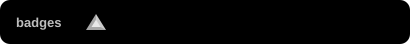

<picture>
  <source media="(prefers-color-scheme: light)" srcset="https://readme-typing-svg.demolab.com?font=Fira+Code&weight=500&size=18&pause=1400&color=000000&center=true&vCenter=true&width=600&lines=parry+/+posture+combat+systems;runtime+research+%26+reverse+engineering;desktop+tooling+%26+animated+launchers;gaming+edits+%26+montages;capri+%E2%80%94+a+signal-core+desktop+companion" />
  
</picture>

### what i do

- **gameplay systems** — Roblox parry / posture combat, character morphs and rigs
- **runtime research** — reverse engineering and Windows internals in C++
- **desktop tooling** — WebView2 launchers and WPF companion apps in C#
- **editing** — gaming edits and montages on [YouTube](https://www.youtube.com/@r3pex), cut in Premiere Pro and DaVinci Resolve
- **web** — [progenitors.ca/repex](https://progenitors.ca/repex), built with vinext on Cloudflare

### projects

<table>
<tr>
<td width="50%" valign="top">

**[Codex-Animated](https://github.com/Synaap/Codex-Animated)** contributor

Animated WebView2 launchers for Devin, Antigravity, Codex & Claude, plus a Theme Studio configurator.

Original launcher by [Synaap](https://github.com/Synaap), startup animation adapted from [panding999](https://github.com/panding999/codex-startup-animation). I added the Devin, Antigravity & Claude launchers, Theme Studio and the theme engine.

</td>
<td width="50%" valign="top">

**Capri** private · in progress

Desktop companion with a signal-core HUD — distinct dormant, listening, thinking and speaking states — and a low-latency neural voice. WPF / C#.

</td>
</tr>
<tr>
<td width="50%" valign="top">

**[Roblox morph tools](https://github.com/Repex13/blender-roblox-morph-tools)**

Blender scripts that turn rigged characters into Roblox R15 morphs: clean up, scale, map bones, fix weights, export FBX and verify, plus morph pads.

</td>
<td width="50%" valign="top">

**[Progenitors](https://progenitors.ca/repex)**

Site for Progenitors, a group of friends from school who build projects together, with a page for each member. vinext on Cloudflare.

</td>
</tr>
<tr>
<td colspan="2" valign="top">

**[Roblox 3D asset pipeline](https://github.com/Repex13/roblox-3d-asset-pipeline)**

The pipeline behind my Roblox meshes: a Hunyuan3D runner plus Blender scripts that weld, decimate, scale, unwrap, bake, export and QA generated sculpts — how it works, no assets.

</td>
</tr>
</table>

### stack

### discord

### activity

<picture>
  <source media="(prefers-color-scheme: dark)" srcset="https://raw.githubusercontent.com/Repex13/Repex13/output/github-snake-dark.svg" />
  <source media="(prefers-color-scheme: light)" srcset="https://raw.githubusercontent.com/Repex13/Repex13/output/github-snake.svg" />
  
</picture>

