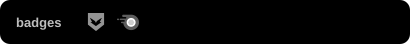

### what i do

- **gameplay systems** — Roblox parry / posture combat, character morphs and rigs
- **runtime research** — reverse engineering and Windows internals in C++
- **desktop tooling** — WebView2 launchers and WPF companion apps in C#
- **web** — [progenitors.ca](https://progenitors.ca/repex), built on Vinxi + Cloudflare

### projects

<table>
<tr>
<td width="50%" valign="top">

**[Codex-Animated](https://github.com/Repex13/Codex-Animated)** fork

Animated WebView2 launchers for Devin, Antigravity & Codex, plus a Theme Studio configurator.

Forked from [Synaap/Codex-Animated](https://github.com/Synaap/Codex-Animated) — the original launcher is Synaap's work, and its startup animation is adapted from [panding999](https://github.com/panding999/codex-startup-animation).

</td>
<td width="50%" valign="top">

**Capri** private · in progress

Desktop companion with a signal-core HUD — distinct dormant, listening, thinking and speaking states — and a low-latency neural voice. WPF / C#.

</td>
</tr>
<tr>
<td width="50%" valign="top">

**Roblox morphs** private

CC-compatible character morphs: Blender modeling and rigging, SurfaceAppearance, RBXM export.

</td>
<td width="50%" valign="top">

**[Progenitors](https://progenitors.ca/repex)** in progress

Community and lore site at progenitors.ca. Vinxi (React Server Components) on Cloudflare.

</td>
</tr>
</table>

### stack

### discord

### activity

<picture>
  <source media="(prefers-color-scheme: dark)" srcset="https://raw.githubusercontent.com/Repex13/Repex13/output/github-snake-dark.svg" />
  <source media="(prefers-color-scheme: light)" srcset="https://raw.githubusercontent.com/Repex13/Repex13/output/github-snake.svg" />
  
</picture>

